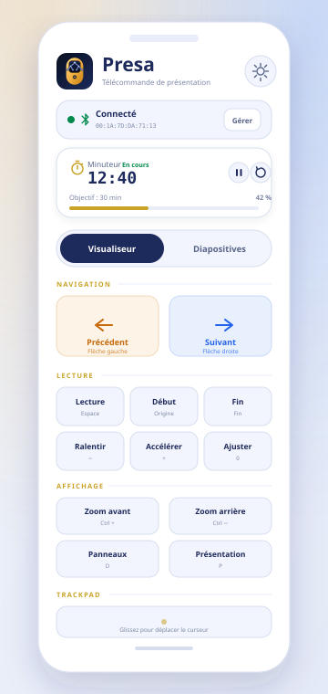
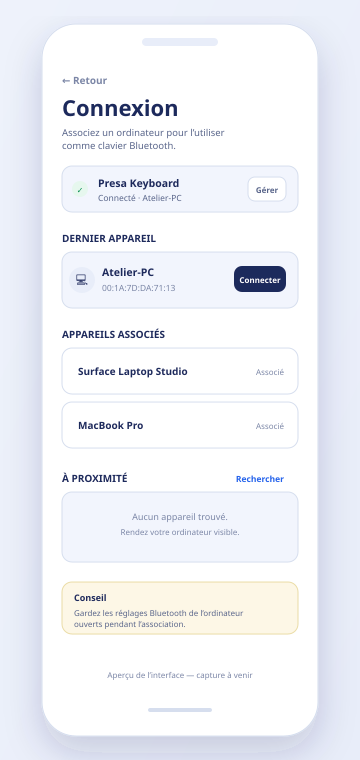
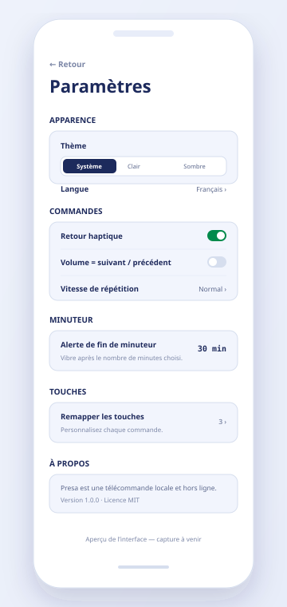
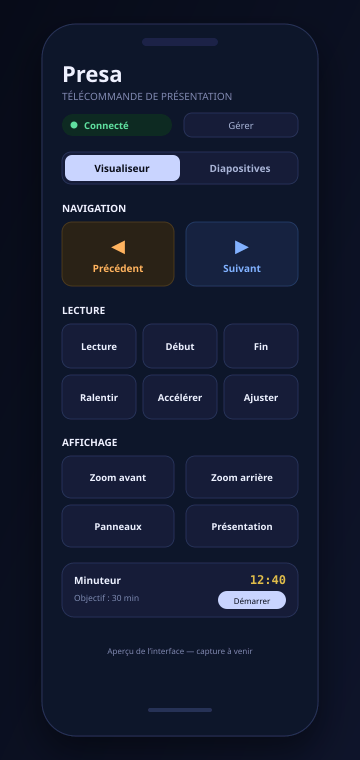

# Presa

**Presa turns an Android phone into a Bluetooth presentation remote — no desktop agent, no dongle, no network.**

Presa registers a standard Bluetooth HID keyboard **and a relative mouse** and sends real key presses and pointer movement to the connected computer, so it works with PowerPoint, Chrome, Acrobat, and the [DSA Visualizer](https://github.com/MehdiCherkane/dsa-visualizer). The on-screen trackpad moves the host cursor without installing anything on the computer. The interface is available in French (default) and English, with light, dark, and system themes.


-3DDC84?logo=android&logoColor=white)


> **Project status:** the app builds, and 46 unit tests cover key maps, HID reports, the composite descriptor, the remap codec, and timer formatting. It has not yet been verified on physical hardware in this repository. Use [docs/TESTING.md](docs/TESTING.md) for the device test plan.

<p>
  
  
  
  
</p>

_The images above are interface previews / screenshot placeholders. Real device captures can replace the SVGs in [`docs/screenshots/`](docs/screenshots/)._

---

## Features

- **Standard Bluetooth HID keyboard and mouse** — uses Android's `BluetoothHidDevice` profile. Nothing to install on the host computer.
- **On-screen trackpad** — drag one finger to move the host cursor, tap to left-click, two-finger drag to scroll, two-finger tap to right-click. Dedicated **Left click** and **Right click** buttons mirror those actions for accessibility.
- **Visualizer mode** — previous/next, play-pause, start/end, speed, zoom, fit, fullscreen, panels, presentation mode, reset, and back, matching the DSA Visualizer shortcuts.
- **Slides mode** — separate **PowerPoint** and **PDF** key sets, including slideshow control, black/white screen, laser/pen/eraser, fullscreen, zoom, and page navigation.
- **Number pad** — jump to a slide (PowerPoint) or a page (Acrobat) by typing a number and pressing Enter.
- **Hold to repeat** — hold Previous/Next to step repeatedly; the delay and interval are configurable.
- **Haptic feedback** — short confirmation vibration on every key press, switchable.
- **Shared lesson timer** — keeps counting while you visit other screens, with a configurable vibration alert (5–120 minutes).
- **Last-host reconnect** — remembers the last computer and reconnects automatically after a dropped connection.
- **Per-button remapping** — every command in all three key maps can be reassigned to another HID usage and modifier combination.
- **Optional volume-key control** — map the phone's volume buttons to Previous/Next while the remote screen is open.
- **Theme and language** — system/light/dark and French/English, applied instantly.
- **Screen stays on** while the remote is open.
- **Fully offline** — no `INTERNET` permission, no analytics, no account.

## Compatibility

| Requirement | Details |
| --- | --- |
| Android | 9.0 (API 28) or newer |
| Hardware | Bluetooth Classic + the **Bluetooth HID Device** profile (`BluetoothHidDevice`) |
| Hosts | Windows 10/11, macOS, Linux (BlueZ), ChromeOS |
| Permissions | Android 12+: **Nearby devices** (`BLUETOOTH_CONNECT`, `BLUETOOTH_SCAN`). Android 9–11: legacy Bluetooth permissions, plus location for device discovery. |

> Some manufacturer firmware does not expose the HID Device profile even on a recent Android version. Presa detects this and shows **“Profil HID indisponible”**. The app cannot add a missing profile to the phone's Bluetooth stack.

> **Upgrading from a keyboard-only build?** The HID descriptor and SDP record changed to a composite keyboard + mouse device. If the trackpad moves nothing after upgrading, remove the old **Presa Keyboard** entry on the computer, then pair again. Windows, macOS, and Linux cache the old descriptor per pairing.

## Build and install

### Prerequisites

- JDK 17
- Android SDK **Platform 35** and **Build Tools 35.0.0**
- Android Studio (optional — the included Gradle wrapper is enough)

Point Gradle at the SDK with `ANDROID_HOME`/`ANDROID_SDK_ROOT`, or create `local.properties`:

```properties
sdk.dir=C\:\\Users\\you\\AppData\\Local\\Android\\Sdk
```

### Commands

**Windows (PowerShell):**

```powershell
$env:JAVA_HOME = "$env:LOCALAPPDATA\Programs\jdk-17"
.\gradlew.bat testDebugUnitTest assembleDebug
adb install -r app\build\outputs\apk\debug\app-debug.apk
```

**macOS / Linux:**

```bash
export JAVA_HOME=/path/to/jdk-17
./gradlew testDebugUnitTest assembleDebug
adb install -r app/build/outputs/apk/debug/app-debug.apk
```

The debug APK is written to `app/build/outputs/apk/debug/app-debug.apk`.

The release build is not signed by default. Add your own signing config in `app/build.gradle.kts` before publishing.

## First run

1. Install and open Presa. Keep the app open — it registers the composite HID keyboard + mouse while the process is alive.
2. Allow **Nearby devices** when prompted (Android 12+). On Android 9–11, grant location access only if you want to scan for unpaired computers; already-paired hosts work without it.
3. Turn on Bluetooth.
4. Pair **Presa Keyboard** from the computer (see below). Presa can also show bonded and nearby devices and request pairing from its Connection screen.
5. Select the computer in Presa, then open the remote and start presenting. The trackpad section sits below the key controls; scroll down to it once the computer is connected.

## Pairing the computer

The phone advertises itself as **Presa Keyboard**. Keep Presa open and its Connection screen visible while pairing.

Pairing can start from either side: if the computer does not list the phone, briefly open the phone's Bluetooth settings to make it discoverable, or scan for the computer from Presa's **Connection** screen and tap **Pair**. Windows and macOS only remain discoverable while their "Add device" / Bluetooth panel is open.

### Windows 10 / 11

1. Open **Settings → Bluetooth & devices → Add device → Bluetooth**.
2. Select **Presa Keyboard**.
3. Confirm the pairing code on the phone and the computer, if asked.
4. If Windows opens a keyboard setup wizard, close it. Presa sends raw HID usages, so the host layout does not change the commands.

If the keyboard is missing, remove any old **Presa Keyboard** entry in Windows, toggle Bluetooth, reopen Presa, and try again. On Windows 11 the entry may appear under **Add device → Bluetooth**.

### macOS

1. Open **System Settings → Bluetooth**.
2. Pair **Presa Keyboard** and confirm the code.
3. If **Keyboard Setup Assistant** opens, close it. No layout calibration is required.

If pairing stalls, remove the existing Presa entry on both devices, toggle Bluetooth, and pair again.

### Linux (BlueZ)

Install and start BlueZ, then use `bluetoothctl`:

```bash
sudo systemctl enable --now bluetooth
bluetoothctl
```

Inside `bluetoothctl`:

```
power on
agent on
default-agent
scan on
pair XX:XX:XX:XX:XX:XX
trust XX:XX:XX:XX:XX:XX
connect XX:XX:XX:XX:XX:XX
scan off
```

Use the phone's Bluetooth address. The GNOME/KDE Bluetooth panels work as well. If input does not arrive after connecting, confirm the device is trusted and run `bluetoothctl info XX:XX:XX:XX:XX:XX`.

## Trackpad

The **Pavé tactile / Trackpad** section appears below the key controls and activates when a computer is connected. It drives the host pointer through the same Bluetooth HID link as the keys — no desktop agent.

| Gesture | Action |
| --- | --- |
| Drag with one finger | Move the pointer |
| Tap with one finger | Left click |
| Drag with two fingers | Scroll vertically or horizontally |
| Tap with two fingers | Right click |
| **Left click** / **Right click** buttons | Explicit click actions, also exposed to TalkBack |

Movement is relative and scaled for a phone-sized surface. Presa coalesces touch events into about one mouse report every 16 ms, so a fast swipe stays smooth without flooding Bluetooth. Scroll follows the natural touch direction: dragging up scrolls down, dragging right scrolls left. The trackpad is disabled while no computer is connected.

> Mouse input needs the composite descriptor introduced with this build. If the keyboard works but the pointer does not, remove the old **Presa Keyboard** pairing on the computer and pair again so the host re-reads the SDP record.

## Remote modes and default keys

Open the mode tabs at the top of the main screen. Presa remembers the last mode and PowerPoint/PDF selection.

### Visualizer

Open the DSA Visualizer in Chrome, click the page once to give it focus, then use Presa.

| Command | Default key | Notes |
| --- | --- | --- |
| Previous | `←` | Hold to repeat |
| Next | `→` | Hold to repeat |
| Play / pause | `Space` | |
| Start | `Home` | |
| End | `End` | |
| Slow down | `↓` | |
| Speed up | `↑` | |
| Zoom in | `Shift` + `=` | |
| Zoom out | `-` | |
| Fit | `0` | |
| Bottom panels | `D` | |
| Presentation mode | `P` | |
| Reset | `R` | Asks for confirmation before sending |
| Main menu | `Esc` | |

### PowerPoint

| Command | Default key | Notes |
| --- | --- | --- |
| Previous | `←` | Hold to repeat |
| Next | `→` | Hold to repeat |
| First slide | `Home` | During the slideshow |
| Last slide | `End` | During the slideshow |
| Start slideshow | `F5` | |
| From current slide | `Shift` + `F5` | |
| Exit slideshow | `Esc` | |
| Black screen | `B` | |
| White screen | `W` | |
| Laser pointer | `Ctrl` + `L` | PowerPoint slideshow |
| Pen | `Ctrl` + `P` | PowerPoint slideshow |
| Eraser | `E` | PowerPoint slideshow |

The number pad types the digits followed by `Enter`, which PowerPoint interprets as **go to slide** while a slideshow is running.

### PDF

| Command | Default key | Chrome PDF | Acrobat |
| --- | --- | --- | --- |
| Previous page | `Page Up` | Previous page / scroll up | Previous page |
| Next page | `Page Down` | Next page / scroll down | Next page |
| First | `Home` | Start of document | First page |
| Last | `End` | End of document | Last page |
| Scroll up | `↑` | Scroll | Scroll |
| Scroll down | `↓` | Scroll | Scroll |
| Fullscreen | `F11` | Toggle fullscreen | — |
| Fullscreen (alt.) | `Ctrl` + `L` | Focus address bar | Toggle fullscreen |
| Zoom in | `Ctrl` + `Shift` + `=` | Zoom in | Zoom in |
| Zoom out | `Ctrl` + `-` | Zoom out | Zoom out |
| Fit | `Ctrl` + `0` | Fit width/page | Fit page |
| Exit | `Esc` | Leave fullscreen | Leave fullscreen |

The number pad sends digits followed by `Enter`. Acrobat interprets that as a page number; Chrome's built-in PDF viewer does not support type-to-page, so use Previous/Next there.

> Host applications own their shortcuts. A few versions of Chrome, Acrobat, or PowerPoint may differ; remap any command in **Settings → Remap keys** if needed.

### Number pad

- Up to **4 digits**.
- Digits are sent 45 ms apart, then `Enter`.
- `←` removes the last digit; **Clear** empties the field.
- In PowerPoint, use it during a slideshow to jump to a slide.
- In Acrobat, use it to jump to a page.

## Timer

The lesson timer lives above the mode content and keeps running while you open Connection, Settings, or Remap.

- Start/pause and reset from the main screen.
- Set the alert target from **Settings → Timer** in 5-minute steps, from 5 to 120 minutes.
- At the target, the phone vibrates and an alert dialog appears.
- The timer is held in memory; it resets when the app process is killed.

## Settings

| Setting | Effect |
| --- | --- |
| Theme | System, light, or dark. |
| Language | French (default) or English. The activity recreates immediately. |
| Haptics | Vibration on key presses; also applies to settings interactions. |
| Volume keys | While the remote screen is open, Volume Up = Next and Volume Down = Previous for the current mode. On other screens the buttons keep their system behavior. |
| Repeat speed | Slow (500 ms / 190 ms), Normal (400 ms / 120 ms), Fast (300 ms / 75 ms). |
| Timer alert | Vibration threshold from 5 to 120 minutes. |
| Remap keys | Per-command modifier and HID key selection, plus per-key or full reset. |
| About | App version, the French and English presentation text, project credits, and GitHub links. |

Settings are stored locally with DataStore. Per-button overrides are compactly encoded as `actionId=modifier:usage;…` and survive restart.

## Permissions and privacy

- **Android 12+:** `BLUETOOTH_CONNECT` and `BLUETOOTH_SCAN` (`neverForLocation`). Only used to find, pair, and connect nearby computers.
- **Android 9–11:** legacy `BLUETOOTH`/`BLUETOOTH_ADMIN`, plus `ACCESS_COARSE_LOCATION`/`ACCESS_FINE_LOCATION` for discovery. Location is not read or stored.
- **Vibration:** the normal `VIBRATE` permission powers button haptics and the timer alert.
- No internet permission. No telemetry, ads, accounts, or cloud services.
- `allowBackup="false"`; settings never leave the device.

## Architecture

Presa uses a small clean-architecture setup with manual dependency injection and unidirectional Compose state.

```
app/src/main/java/com/presa/app/
├── MainActivity.kt              # Locale wrapping, keep-screen-on, volume key routing
├── PresaApplication.kt          # Owns AppContainer
├── di/AppContainer.kt           # Preferences, HID manager, haptics, router
├── data/
│   ├── PresaPreferences.kt      # DataStore settings + last host
│   ├── LocaleStore.kt           # Synchronous locale mirror for attachBaseContext
│   ├── KeyRemapCodec.kt         # Stable override serialization
│   ├── Haptics.kt
│   ├── BluetoothPermissions.kt
│   └── VolumeKeyRouter.kt
├── domain/
│   ├── hid/
│   │   ├── BluetoothHidManager.kt  # Registration, connect, reconnect, keyboard/mouse writes
│   │   ├── HidReport.kt            # Keyboard and mouse report builders
│   │   ├── HidModels.kt            # Composite descriptor, state, errors
│   │   └── ...
│   └── model/
│       ├── KeyMaps.kt              # Data-driven Visualizer/PowerPoint/PDF maps
│       ├── KeyAction.kt
│       ├── KeyChord.kt             # Modifier + HID usage
│       └── PresaModels.kt          # Modes, theme, language, repeat speed
└── ui/
    ├── PresaApp.kt                 # Permission gate, navigation, snackbars
    ├── presentation/               # Remote screen, trackpad, modes, ViewModel
    ├── connection/                 # Bonded/nearby hosts, status, ViewModel
    ├── settings/                   # Settings and key remapping
    ├── timer/                      # Shared timer + alert host
    ├── components/                 # Buttons, cards, number pad, labels
    └── theme/                      # DSA Visualizer palette and typography
```

**HID flow:** a tap builds a `KeyChord`, the ViewModel passes it to `BluetoothHidManager`, which serializes report writes with a mutex. Each press sends key-down, waits briefly, then key-up; the key-up report has no modifiers, so a modifier cannot stay stuck on the host. Trackpad touches are queued in the ViewModel, coalesced into relative deltas, and sent as mouse reports through the same mutex; clicks stay atomic so a move cannot land between press and release. Key maps are plain data, so remapping and tests do not touch the transport.

**Design system:** colors, surfaces, and semantic tokens are adapted from the DSA Visualizer's light/dark palette. Typography uses the Android system sans and monospace families.

## Tests

```bash
./gradlew testDebugUnitTest
```

46 unit tests cover:

- default HID usages and modifiers for all three key maps,
- action-id uniqueness and override application,
- keyboard and mouse report layout, button masks, clamping, and release behavior,
- composite descriptor size, report IDs, and keyboard/mouse collection structure,
- remap codec round-trips and malformed input,
- timer clock formatting.

For the full manual device checklist — Chrome visualizer, PowerPoint, Chrome PDF, and Acrobat — see [docs/TESTING.md](docs/TESTING.md).

## Troubleshooting

| Symptom | Fix |
| --- | --- |
| **“Profil HID indisponible”** | The phone firmware does not expose Bluetooth HID Device. Try another phone or a ROM that supports it. |
| Computer cannot find **Presa Keyboard** | Keep Presa open, turn Bluetooth on, and remove stale Presa entries on the computer. On Windows use **Add device → Bluetooth**; on Linux make sure `bluetooth` is running. |
| Paired but no keys arrive | Open Presa, connect from the Connection screen, and test in a text editor. Remove the pairing on both sides and pair again. |
| Keyboard works but the trackpad does nothing | The host cached the old keyboard-only descriptor. Remove **Presa Keyboard** on the computer, then pair again. Also confirm the app shows **Connected**, since the trackpad is disabled otherwise. |
| Trackpad pointer is too slow or too fast | Presa applies a fixed phone-sized gain; use shorter or longer swipes. Fast swipes are clamped to the HID report range instead of being dropped. |
| Windows sees the keyboard but shortcuts do nothing | Click the presentation window to focus it first. Then test `←`/`→` in Notepad to isolate HID from app shortcuts. |
| Mac opens Keyboard Setup Assistant | Close the assistant. It is not needed for raw HID reports. |
| Linux connects but receives no input | Run `bluetoothctl trust <MAC>` and `connect <MAC>`, then check `bluetoothctl info <MAC>`. |
| Connection drops mid-presentation | Presa retries the last host up to three times. Tap **Reconnect** on the status bar if it stops. |
| Previous/Next advance too slowly | Use **Settings → Repeat speed → Fast**. The initial hold delay is also shortened. |
| Volume buttons change media volume instead | Enable **Settings → Volume keys** and stay on the remote screen; other screens intentionally keep system volume behavior. |
| Key mapping feels wrong | Open **Settings → Remap keys** and reset the individual key or all keys. |
| Build fails: SDK not found | Set `ANDROID_HOME` or create `local.properties` with `sdk.dir`. Android SDK Platform 35 is required. |
| Pairing scan shows nothing | Grant **Nearby devices**; on Android 9–11 grant location. Hosts already paired in system settings still appear under Bonded devices. |

## Limitations and roadmap

- **HID Device profile required** — software cannot add this profile to unsupported firmware.
- **Foreground use** — Presa is designed to stay open during a presentation; the screen is kept awake. Aggressive battery managers may kill the process if the app is left in the background.
- **Single-key reports** — one chord at a time; no multi-key gaming/NKRO support.
- **Relative trackpad only** — the pointer moves relative to its current position, like a laptop trackpad. There is no absolute tablet mapping, drag-lock, or three-finger gesture.
- **Host gesture differences** — two-finger scrolling and right-click are standard HID mouse behavior, but individual applications may interpret wheel or pan events differently.
- **Screenshots** — the images in this repository are previews, not real device captures.

## About and credits

Presa turns an Android phone into a Bluetooth presentation remote. No data leaves your phone: key presses and pointer movement are sent directly to the computer as a standard HID keyboard and mouse.

Presa transforme un téléphone Android en télécommande de présentation Bluetooth. Aucune donnée ne quitte votre téléphone : les touches et les mouvements du curseur sont envoyés directement à l’ordinateur comme ceux d’un clavier et d’une souris HID standard.

Created by **El Mahdi Cherkane**, **Omar Moussaid** and **Hamza Agour** — **EST Béni Mellal**, d’après le cours du Pr. M. OUTANOUTE.

- [DSA Visualizer on GitHub](https://github.com/MehdiCherkane/dsa-visualizer)
- [Presa on GitHub](https://github.com/HamzaAGOUR/Presa)

## License

[MIT](LICENSE) © 2026 EL MAHDI CHERKANE.

The palette and visual direction are inspired by [DSA Visualizer](https://github.com/MehdiCherkane/dsa-visualizer).
